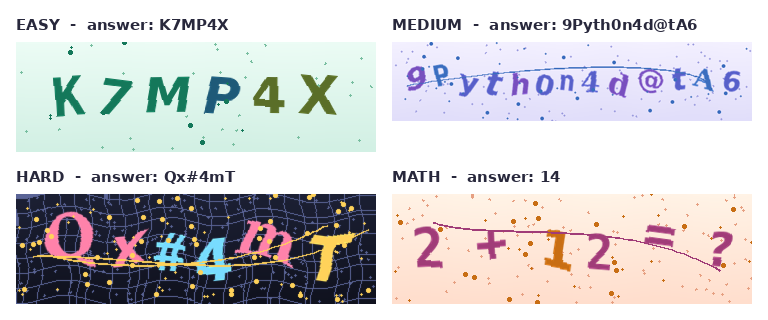
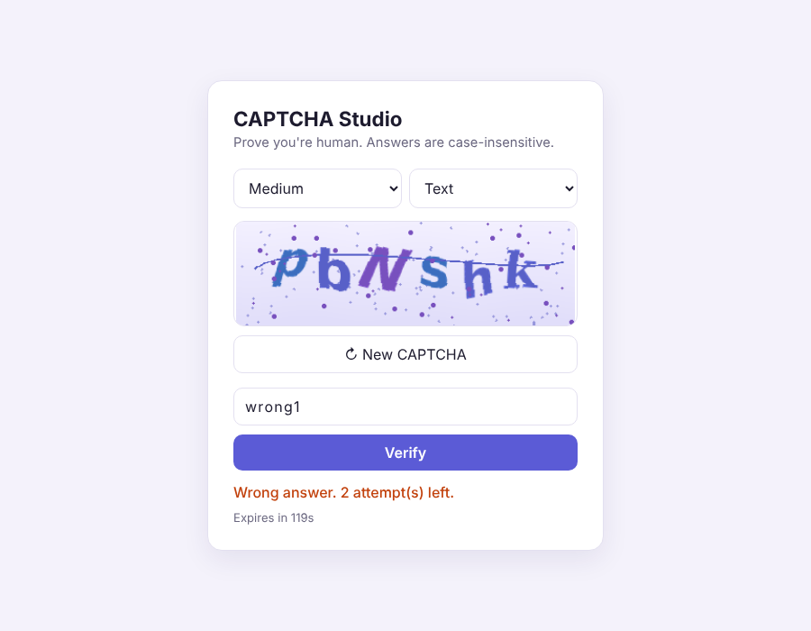

# 🔐 CAPTCHA Studio

**An advanced image & audio CAPTCHA system in Python** - a custom image-distortion engine,
three difficulty levels, math challenges, a secure verification backend, a Flask web app,
a CLI, and unit tests.




---

## ✨ Features

| | |
|---|---|
| 🎨 **Custom image engine** | Built from scratch with Pillow + NumPy: per-character rotation & colour, overlap, sine-wave warping, Bezier interference curves, noise, grid and blur |
| 📶 **3 difficulty levels** | `easy`, `medium`, `hard` presets - every parameter can be overridden |
| 🌈 **4 themes** | `lavender`, `mint`, `sunset`, `night` |
| ➗ **Math CAPTCHA** | `7 + 5 = ?` style challenges |
| 🔊 **Audio CAPTCHA** | Spoken digits for visually-impaired users |
| 🛡️ **Secure verification** | HMAC-SHA256 hashed answers, constant-time comparison, expiry, single-use, attempt limit, rate limit |
| 🎲 **Secure randomness** | `secrets` module; look-alike characters (`0/O`, `1/l/I`) removed |
| 🌐 **Web app** | Flask app with refresh, listen, countdown and JSON API |
| ⌨️ **CLI** | Generate CAPTCHAs in bulk from the terminal |
| ✅ **Tested** | 17 unit tests (generator, verifier, web API) |

## 🖥️ Web demo



## 🚀 Quick start

```bash
git clone https://github.com/<your-username>/captcha-studio.git
cd captcha-studio
pip install -r requirements.txt

python app.py                 # web app -> http://127.0.0.1:5000
python -m unittest discover tests     # run the tests
```

## 🧑‍💻 Usage

### Python

```python
from captcha_studio import ImageCaptchaGenerator, CaptchaManager, VerifyResult

# 1. Just make an image
gen = ImageCaptchaGenerator("hard", theme="night")
gen.save("9Pyth0n4d@tA6", "captcha.png")

# 2. Full issue -> verify flow (what a website backend does)
mgr = CaptchaManager(ttl_seconds=120, max_attempts=3)
challenge = mgr.issue(difficulty="medium", mode="text")   # or mode="math"
open("challenge.png", "wb").write(challenge.image_png)

result = mgr.verify(challenge.id, input("Answer: "))
print(result)   # VerifyResult.OK / WRONG / EXPIRED / TOO_MANY_ATTEMPTS / NOT_FOUND
```

### Command line

```bash
python -m captcha_studio generate --text 9Pyth0n4d@tA6 --difficulty hard
python -m captcha_studio generate --count 10 --difficulty medium --theme mint --out output/
python -m captcha_studio audio --text 978 --out output/audio.wav
python -m captcha_studio demo --mode math        # solve one in the terminal
```

### REST API (from `app.py`)

| Method | Endpoint | Description |
|---|---|---|
| `POST` | `/api/captcha` | body `{"difficulty": "hard", "mode": "text"}` → new challenge |
| `GET` | `/api/captcha/<id>.png` | challenge image |
| `GET` | `/api/captcha/<id>.wav` | audio version (numeric challenges) |
| `POST` | `/api/verify` | body `{"id": "...", "answer": "..."}` → result |
| `GET` | `/api/stats` | issued / passed / failed / expired counters |

## ⚙️ How it works

```
 random text (secrets)
        │
        ▼
 gradient background ─► background dots / grid
        │
        ▼
 each character on its own layer: random font · size · rotation · colour
        │
        ▼
 paste with overlap + vertical jitter ─► sine-wave warp ─► Bezier curves ─► speckles ─► blur
        │
        ▼
 PNG sent to user        HMAC-SHA256(id + answer) kept on server  (never the answer itself)
```

**Why each step?**
- **Rotation / overlap** stop simple character segmentation.
- **Sine-wave warp** bends straight lines so template matching fails.
- **Interference curves & noise** confuse thresholding and contour detection.
- **Hashed answers + expiry + attempt limit** stop replay and brute-force attacks.

## 📁 Project structure

```
captcha-studio/
├── captcha_studio/
│   ├── __init__.py
│   ├── __main__.py        # CLI
│   ├── text.py            # secure random text & math challenges
│   ├── image_engine.py    # image CAPTCHA renderer
│   ├── audio_engine.py    # audio CAPTCHA
│   └── manager.py         # issue / verify / expire / rate-limit
├── notebooks/
│   ├── 01_Basic_CAPTCHA_original.ipynb
│   └── 02_Advanced_CAPTCHA.ipynb
├── templates/index.html   # web page
├── fonts/                 # DejaVu fonts (free licence)
├── samples/               # example images + audio
├── static/web_demo.png
├── tests/test_captcha_studio.py
├── app.py                 # Flask web app
├── make_samples.py        # regenerate the sample images
└── requirements.txt
```

## 🔮 Future work
- Train a CNN on generated images to measure how robust each difficulty level is
- Redis storage so several servers can share challenges
- Image-selection CAPTCHA ("select all squares with ...")

## 🙏 Credits
- Basic version inspired by the *Encode CAPTCHA* mini-project in
  [91 Python Mini Projects](https://github.com/milaan9/91_Python_Mini_Projects).
- Audio uses the [`captcha`](https://pypi.org/project/captcha/) library.
- Fonts: [DejaVu](https://dejavu-fonts.github.io/) (free licence).

## 📄 License
MIT - see [LICENSE](LICENSE).
